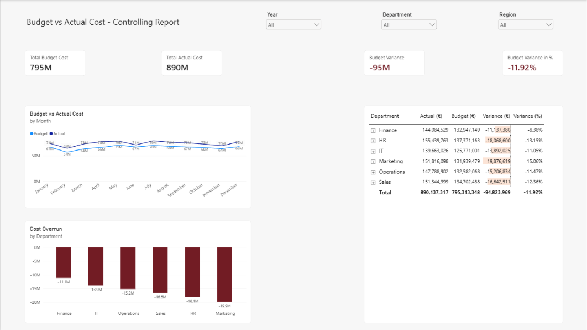

# End-to-End Controlling ETL Pipeline & Budget Variance Analysis



## 📌 Project Overview & Business Problem

In financial controlling, reliable Plan-vs-Actual reporting is essential to identify cost overruns early and steer departmental budgets effectively. However, raw transactional exports often suffer from missing IDs, incomplete master data, and duplicate entries.

This project demonstrates a complete **end-to-end BI & Controlling workflow**:

1. **Extract, Transform & Load (Python):** Automated ingestion, data quality validation, and transformation of raw financial CSV data into a normalized relational **Star Schema**.
2. **Data Warehousing (MySQL):** Storage with enforced primary key constraints and analytical SQL queries using Common Table Expressions (CTEs) and Window Functions.
3. **Management Reporting (Power BI):** Interactive executive dashboard following IBCS-inspired design principles for variance and trend analysis.

---

## 🏗️ Data Architecture & Star Schema

```text
+-----------------------+       +------------------------+       +-------------------+

|  Raw CSV Export       | ----> |  Python ETL Pipeline   | ----> |  MySQL Database   |
| (Budget_vs_Actual.csv)|       | (Pandas & SQLAlchemy)  |       |  (Star Schema)    |
+-----------------------+       +------------------------+       +---------+---------+
                                                                           |
                                                                           v
                                                                 +-------------------+

                                                                 |  Power BI Report  |
                                                                 | (DAX & Visuals)   |
                                                                 +-------------------+
```

The relational database (`controlling_portfolio`) is modeled as a **Star Schema** to optimize analytical queries and BI performance:

* **Fact Table (`fact_transactions`):** Contains `transaction_id` (PK), `date`, foreign keys to all dimensions, `budget_amount`, and `actual_amount`.
* **Dimension Tables:** `dim_department`, `dim_category`, `dim_region`, and `dim_payment`.

---

## 🧹 Data Cleaning & Quality Assurance (`etl_pipeline.py`)

To ensure financial auditability and prevent silent errors in management reporting, the Python pipeline implements strict cleaning rules and `assert`-based quality gates:

* **Deduplication:** Identified and removed exact duplicate transaction records.
* **Sequential ID Reconstruction:** Analyzed the raw dataset structure and reconstructed missing `Transaction IDs` (`TXN...`) using regex extraction and sequential forward-filling (`+1`), followed by uniqueness assertions.
* **Master Data Handling:** Removed incomplete records lacking mandatory accounting dimensions (`Department` or `Category`), while imputing missing geographical attributes as `'Unknown'` to preserve total financial volume.
* **Security:** Database credentials are decoupled from source code via environment variables (`.env`).

---

## 📊 Key Controlling Insights

Based on the analytical SQL queries (`controlling_analysis.sql`) and the Power BI drill-down matrix, the following core business findings were identified:

* **Overall Budget Overrun:** Total actual costs reached **€890.14M** against a planned budget of **€795.31M**, resulting in an unfavorable total budget variance of **-€94.82M (-11.92%)**.
* **Main Cost Drivers by Department:** Every department exceeded its allocated budget. **Marketing** recorded the highest absolute and relative overrun (**-€19.88M / -15.06%**), followed by **HR** (**-€18.07M / -13.15%**) and **Sales** (**-€16.64M / -12.36%**). **Finance** demonstrated the strongest cost discipline (**-8.38%** / **-€11.14M**).
* **Root-Cause Analysis by Cost Category (Drill-Down):**
  * **Single Largest Overruns:** **Training** in **Marketing** showed the highest individual overrun across the entire dataset (**-€5.50M / -25.84%**), followed by **Travel** in **Marketing** (**-€4.13M / -19.95%**) and **Salaries** in **Operations** (**-€4.12M / -20.91%**).
  * **Structural Salary Variance:** **Salaries** consistently exceeded planned budgets across all departments—most notably in **Operations (-20.91%)**, **IT (-20.03%)**, and **Marketing (-16.71%)**, pointing to unbudgeted headcount growth or overtime costs.
  * **Only Positive Variance:** Across all 36 department-category combinations, **Training in Operations** was the sole cost center that stayed within budget (**+€58.00K / +0.23%**).
* **Seasonality & Monthly Trends:** Actual monthly expenses tracked above planned budgets throughout the entire year, peaking between **April and July** (~€78M–€79M per month) after a seasonal dip in February (€65M).

---

## 🛠️ Tech Stack

* **Programming & ETL:** Python 3 (`pandas`, `sqlalchemy`, `pymysql`, `python-dotenv`, `logging`)
* **Database & Querying:** MySQL (Star Schema Modeling, CTEs, Window Functions `SUM() OVER`, `RANK() OVER`)
* **BI & Visualization:** Microsoft Power BI Desktop (Data Modeling, DAX Measures, Drill-Down Matrix)

---

## 🚀 How to Run This Project Locally

1. **Clone the repository:**

   ```bash
   git clone https://github.com/isa2097/controlling-etl-portfolio/tree/main
   cd controlling-etl-portfolio
   ```
2. **Install required Python packages:**

   ```bash
   pip install -r requirements.txt
   ```
3. **Configure environment variables:**
   Create a `.env` file in the root directory based on `.env.example` and add your local MySQL credentials:

   ```env
   DB_USER=root
   DB_PASSWORD=your_password
   DB_HOST=localhost
   DB_PORT=3306
   DB_NAME=controlling_portfolio
   ```
4. **Run the ETL pipeline:**

   ```bash
   python etl_pipeline.py
   ```
5. **Explore SQL & Power BI:**

   * Execute the analytical queries in `controlling_analysis.sql` against your MySQL instance.
   * Open `controlling_report.pbix` in Power BI Desktop to interact with the dashboard.
